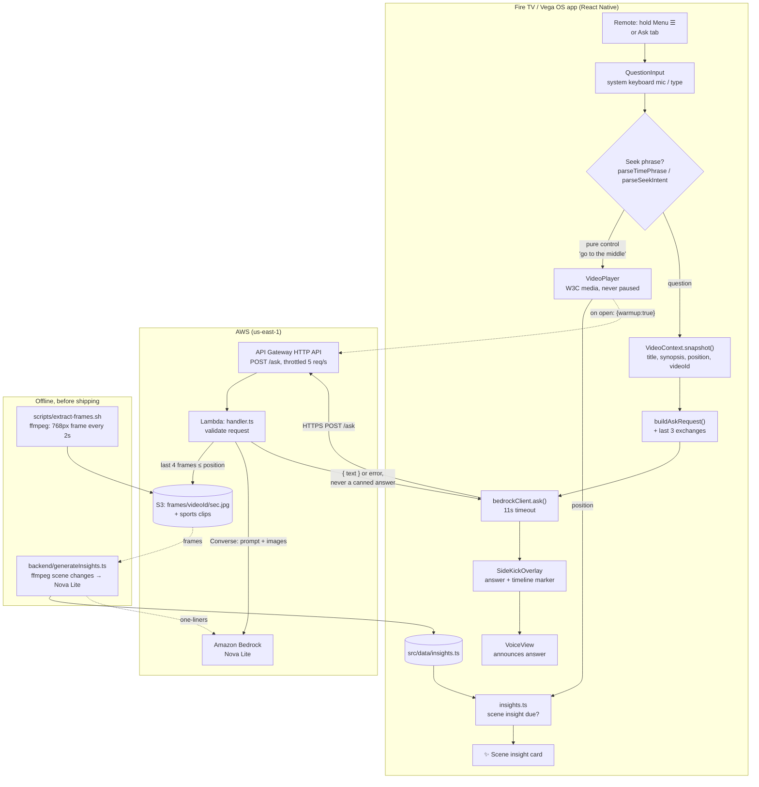

# Wait, What? — talk to your timeline

> Hold one button and ask about anything you're watching. Wait, What? answers in a
> non-blocking overlay **without pausing playback**, anchors every answer to the
> moment you asked, lets you **navigate by natural language**, **sees the actual
> frames** of what you're watching, surfaces **scene insights unprompted**, and
> announces answers through **VoiceView** for low-vision viewers.

Built for the **Build, Ship, Shape: Amazon Developer Hackathon** — Fire TV track
(priority categories: *AI-enhanced viewing*, *sports*, *multi-modal UX*,
*accessibility*) with the **AWS Builder** mini challenge (Amazon Bedrock).

---

## Quick start

**You need:** the [Vega SDK](https://developer.amazon.com/vega) (`vega` CLI), Node 18+,
and a Fire TV (Vega OS) device or the Vega Virtual Device.

```bash
# 1. Get the code and dependencies
git clone https://github.com/Sk031397/WaitWhat.git
cd WaitWhat
source $HOME/vega/env          # load the Vega SDK (every new terminal)
npm install

# 2. Start the Virtual Device (with a window), build, install and launch
vega virtual-device start --gui
npm run build:debug
vega run-app build/x86_64-debug/sidekick_x86_64.vpkg
```

**Try it:** open **Tears of Steel** → a ✨ scene insight appears at 0:10 → hold the
remote's **Menu (☰)** (or select **Ask Wait, What?**) → ask *"What's happening right
now?"* or *"Take me to the middle and tell me what's happening"*. Then open a game
from the **Sports** row and ask *"Break down this play"*.

The app talks to an already-deployed backend (`ASK_ENDPOINT` in `src/config.ts`),
so you don't need AWS credentials, keys or any config to run it. To deploy your own backend, see
[Backend](#2-backend-the-bedrock-endpoint). Tests: `npm test` (app) and
`cd backend && npm test`.

---

## The idea

Everyone reaches for their phone while watching — *who's that actor, what did I
miss, what's this scene, what are his stats?* Wait, What? answers on the TV,
**without pausing**, grounded on what's playing and where you are in it.

The deeper idea: **the timeline becomes something you talk to.** Wait, What? is one
companion pipeline that:

- **answers** questions about the current title/scene via a live Amazon Bedrock
  call, grounded on the content and your exact playback position;
- **navigates** on command — "take me to 0:10 and tell me what's happening", "go
  to the middle", "go a quarter of the way", "go to the end" — seeking there and
  explaining the moment (it controls playback; it never refuses to rewind);
- **remembers** — every question drops a marker on the scrubber, and a
  "Your questions" row lets you jump back to any moment and re-surface its answer;
- **adapts to sports** — open a game and the same gesture enters **sports
  mode**: Wait, What? re-themes and grounds its live Bedrock answers on the game
  context and the real frames, so "catch me up" or "break down this play"
  answer in the moment (amateur, license-clear footage; no real teams);
- **sees the screen** — every question carries real frames extracted from the
  video up to your position, so "what's happening right now?" is answered from
  the footage itself (and it can't spoil what's ahead);
- **anticipates** — when a new scene starts, a small ✨ scene-insight card
  surfaces what's on screen without being asked (pre-generated from the real
  frames, so it costs nothing at playback time);
- **is one hold away** — hold the remote's Menu (☰) button from anywhere in the
  player and the panel opens with the keyboard and its mic already up;
- **narrates** — answers are announced through VoiceView, so a low-vision viewer
  hears what's on screen.

It's not a chat window bolted onto a video — it's a companion that understands
the content *and where you are in it*.

---

## Architecture



(A rendered copy is in [`docs/architecture.png`](docs/architecture.png).)

**How a question flows:** the viewer holds Menu (☰) and asks. Pure seek commands
("go to the middle") are handled on the TV with no network call. Everything else
becomes a grounded request (title, synopsis, playback position, video id, recent
exchanges) sent to API Gateway. The Lambda validates the request, loads the last
four frames at or before the position from S3, and sends them with the question to
Nova Lite. The answer appears in the side panel, drops a marker on the timeline and
is announced by VoiceView, while the video keeps playing. Scene insights are
generated offline from the same frames and ship with the app.

### Why not `react-native-video`?

Vega OS does **not** support `react-native-video` (it wraps ExoPlayer/AVPlayer,
which Vega doesn't use). Vega uses the **W3C MSE/EME** standard via
`@amazon-devices/react-native-w3cmedia`. Even Amazon's own
`react-native-multi-tv-app-sample` swaps to W3C media on its Vega target.

`src/player/VideoPlayer.tsx` is a thin wrapper that exposes a familiar
`react-native-video`-style API (`source`, `paused`, `onLoad`, `onProgress`,
`onEnd`, `onError`) while driving `VideoPlayer` + `KeplerVideoSurfaceView`
underneath. App code stays idiomatic; the platform-native player does the work.

---

## Project layout

```
.
├── manifest.toml              # Vega manifest: media services, audio, deep links, os.version
├── babel.config.js            # automatic JSX runtime (required by react-native-w3cmedia)
├── package.json               # react-native-w3cmedia — NOT react-native-video
├── src/
│   ├── App.tsx                # stack navigator: Home → Player (no drawer)
│   ├── index.js               # AppRegistry.registerComponent(appName, …) from app.json
│   ├── config.ts              # ASK_ENDPOINT (deployed backend URL)
│   ├── screens/
│   │   ├── HomeScreen.tsx      # hero header + horizontal content rows
│   │   └── PlayerScreen.tsx    # full-screen video + controls + overlay
│   ├── components/
│   │   ├── FocusableCard.tsx   # grid tile w/ animated focus bloom
│   │   ├── PlayerControls.tsx  # play/pause, ±10s, seek bar + "Your questions" chips
│   │   ├── GradientScrim.tsx   # dependency-free faux gradient
│   │   └── Vignette.tsx        # cinematic edge darkening
│   ├── player/
│   │   ├── VideoPlayer.tsx     # W3C media wrapped in a react-native-video-like API
│   │   └── useVideoContext.tsx # context capture + navigable timeline (markers, seek)
│   ├── sidekick/              # THE DIFFERENTIATOR
│   │   ├── SideKickOverlay.tsx # slide-out answer panel, hold-☰ handler, insight card
│   │   ├── QuestionInput.tsx   # TextInput → system-keyboard mic (Vega voice path)
│   │   ├── ModeRouter.ts       # builds the grounded AskRequest
│   │   ├── insights.ts         # when a proactive scene insight is due
│   │   └── bedrockClient.ts    # calls /ask; shows an error if unreachable
│   ├── util/
│   │   ├── parseTimePhrase.ts  # natural-language seek: "0:10", "the middle", "a quarter"
│   │   └── formatTime.ts
│   ├── data/                  # catalog, shared types, generated insights.ts
│   └── theme/                 # 10-foot scaling + colors + motion tokens
├── test/                      # Jest unit tests (time phrases, seek intent, insights, catalog)
├── scripts/
│   └── extract-frames.sh      # every catalog video → a 768px frame every 2s → S3
└── backend/                   # the AWS Builder piece
    ├── handler.ts             # Lambda: loads frames from S3 → Bedrock Nova Lite (Converse)
    ├── deploy.sh              # update the live Lambda code/env, throttle the API, smoke test
    ├── template.yaml          # SAM reference (deployed via API Gateway + Lambda)
    ├── generateInsights.ts    # offline: frames → scene changes → Nova Lite notes
    ├── devServer.ts           # local http wrapper for the handler
    └── test.ts                # validation, auth, warm-up and error-path checks (no AWS needed)
```

---

## Run it

### Prerequisites
- Vega SDK installed (`vega` / `kepler` CLI on PATH) — https://developer.amazon.com/vega
- Node 18+
- A Fire TV (Vega OS) device **or** the Vega simulator

### 1. App (on device / simulator)

```bash
# Load the Vega SDK into your shell (every new terminal)
source $HOME/vega/env

npm install

npm test        # Jest unit tests
npm run lint

# Build the app (bundles RN, runs kmmb, packages the .vpkg)
npm run build:debug
#   → produces build/<arch>-debug/sidekick_<arch>.vpkg

# Install + launch on a connected Vega device / simulator
vega run-app build/x86_64-debug/sidekick_x86_64.vpkg
```

For live development with Fast Refresh (two terminals):

```bash
# Terminal A — Metro bundler
source $HOME/vega/env && npm start

# Terminal B — build + launch
source $HOME/vega/env && npm run build:debug
```

> Verified with Vega SDK 0.24, CLI 1.4.4, RN 0.72: `tsc --noEmit` clean,
> `vega project doctor` all-pass, `npm run build:debug` exits 0 and emits
> `.vpkg` for armv7 / aarch64 / x86_64.
>
> The home grid has Blender open films and a **Sports** row; open any title to watch.
> Hold the remote's **Menu (☰)** button (or select the **Ask Wait, What?** tab) and
> the panel opens with the question field focused; type, or on a device hold the
> Alexa button to dictate. On Tears of Steel a ✨ scene-insight card appears at 0:10
> without asking. Try a navigation phrase like *"go to the middle"*
> or *"take me to 0:10 and tell me what's happening."* Open a **Sports** game to see sports mode:
> Wait, What? re-themes and answers "catch me up" / "what just happened?" grounded on
> what's on screen (license-clear amateur footage, no real teams).

### 2. Backend (the Bedrock endpoint)

```bash
cd backend
npm install
npm test        # validation/auth/error-path tests, no AWS creds needed

# Option A — run locally
npm run dev     # http://localhost:3000/ask  (uses your shell AWS creds for Bedrock)

# Option B — update the live Lambda + API (what this project uses)
./deploy.sh

# Option C — deploy fresh with SAM
npm run build
sam deploy --guided --template-file template.yaml
# Copy the AskEndpoint output URL
```

Frames: run `scripts/extract-frames.sh` once (and again whenever a video
changes) to extract a frame every 2s from every catalog video and upload them
to `s3://sidekickvegaos/frames/<videoId>/<second>.jpg`.

Scene insights: after the frames are up, run `cd backend && npm run insights`
(needs ffmpeg; set `FFMPEG=/path/to/ffmpeg` if it isn't on PATH). It finds scene
changes in each video's frames, asks Nova Lite for a one-line note per new
scene, and writes `src/data/insights.ts`, which ships with the app. Rebuild the
app afterwards.

Then point the app at the endpoint — in `src/config.ts` set `ASK_ENDPOINT`, or
call `setAskEndpoint('https://…/ask')` at startup. (A live API Gateway endpoint
is already wired in `src/config.ts` for this submission.)

The endpoint needs no key: anything shipped inside a TV app can be extracted,
so instead the API stage is throttled (5 req/s, burst 10) and the Lambda's
concurrency is capped, which bounds Bedrock cost.

### Bedrock access
Enable model access for an **Amazon Nova** model in your region
(`aws bedrock list-inference-profiles --region us-east-1` to confirm the id).
The deployed handler uses the cross-region inference profile
`us.amazon.nova-lite-v1:0` (multimodal — it reads the frames); override with the
`BEDROCK_MODEL_ID` env var.
(First-party Nova models need no AWS Marketplace subscription; third-party
models like Claude do.)

---

## No canned answers

Every answer comes from the model. If the backend or Bedrock is unreachable,
the server returns an error (503) and the app says it couldn't reach Wait,
What? — it never substitutes a pre-written answer. Failed attempts don't drop a
timeline marker. If frames are missing for a moment, the model is told it can't
see the screen and says so rather than guessing.

---

## How this maps to the judging criteria

| Criterion | Where it shows up |
|---|---|
| **Tech Implementation** | Correct Vega W3C media stack (not react-native-video), manifest media services, deployed Amazon Bedrock backend behind API Gateway + Lambda with least-privilege IAM, untrusted-input validation, honest error handling (no canned answers) |
| **Design** | One hold-to-ask gesture, non-blocking slide-out panel, **animated focus bloom**, cinematic vignette, timeline-anchored answers with a **navigable Q&A history**, context-themed **sports mode** (accent re-theme), 10-foot scaling, accessible focus (border + scale, not color alone) |
| **Potential Impact** | Near-universal behaviors (ask about what you're watching, catch up on a game) solved without leaving the screen — **plus an accessibility layer** (answers spoken via VoiceView for low-vision viewers) and a **content-agnostic pipeline any streaming app could embed** |
| **Quality of the Idea** | **Talk to your timeline** — ask, navigate by natural language, revisit any question on the scrubber, answers grounded in the actual video frames, **scene insights that surface unprompted**, and an adaptive **sports mode** that re-themes and grounds live answers on the game. One companion that understands what you're watching *and where you are in it*. |

---

## Who this is for (potential impact)

Wait, What? solves behaviors that are near-universal, and it reaches audiences a
plain companion app would miss:

- **Everyone who reaches for their phone mid-show** — "who is that actor?",
  "what's happening right now?" — answered on the TV without pausing.
- **Anyone who wants to move around the content hands-free** — "take me to the
  middle", "go back to 0:10 and tell me what's happening" — natural-language
  navigation that seeks *and* explains, instead of blind scrubbing.
- **Sports fans who join late** — open a game and ask "catch me up" or "what
  just happened?"; Wait, What? answers in the moment, grounded on what's on
  screen (license-clear amateur footage, no real teams).
- **Low-vision viewers (accessibility).** Its answers are announced
  through **VoiceView**, so a viewer who can't read the panel still hears what's
  on screen and what's happening. On VegaOS, VoiceView is the supported
  speech-output path; Wait, What? is built to use it.
- **Any streaming app, not just this one.** The pipeline is content-agnostic —
  it takes "what's playing + where you are + a question" and returns a grounded
  answer. It's designed to drop into an existing catalog app as a companion
  layer, which is the path beyond this hackathon.

---

## AWS Builder mini challenge — write-up

**Services used**

- **Amazon Bedrock (Nova Lite) via the Converse API** (`@aws-sdk/client-bedrock-runtime`).
  `backend/handler.ts` loads the last few real frames up to the viewer's
  position from S3 and sends them as image blocks with the question, plus a
  system prompt grounding the title, synopsis, cast, and recent exchanges
  (for follow-ups). `maxTokens: 150`, `temperature: 0.3`.
- **Amazon S3** — hosts the sports clips and the extracted frames
  (`frames/<videoId>/<second>.jpg`), read by the Lambda.
- **Amazon API Gateway (HTTP API) + AWS Lambda** — public HTTPS `/ask` endpoint
  with CORS; the Lambda holds the Bedrock integration. (A Function URL was tried
  first; this account blocks public Function URLs, so an HTTP API fronts the
  Lambda instead — documented in the build history.)
- **IAM** — least-privilege role scoped to `bedrock:InvokeModel*` on Nova
  models + inference profiles, and `s3:GetObject` on the media bucket.
- **Cost guards** — API Gateway throttling (5 req/s, burst 10); the endpoint
  needs no key, so the app runs straight from a clone. (`deploy.sh` also tries to reserve Lambda concurrency, but
  this account's concurrency limit is too low to allow it, so throttling is the
  cap.)
- **Bedrock, offline** — `backend/generateInsights.ts` sends frames at each
  detected scene change to Nova Lite once, ahead of time, to write the scene
  insights. They ship with the app, so playback costs no extra calls.

**Practices applied from AWS guidance**

- `maxTokens` set explicitly (avoids the silent 43× quota reservation that causes
  ThrottlingException).
- Cross-region inference profile id (`us.` prefix) for availability.
- One retry inside a fixed time budget (`maxAttempts: 2`, 8s abort) so the
  backend never outlives the app's 11s timeout.
- Request body treated as untrusted: validated shape + clamped to 300 chars
  before entering the prompt.
- No AWS credentials ever ship in the TV app — Bedrock is only ever called
  server-side.
- No canned answers: failures are reported as failures.
- A warm-up ping when the player opens keeps the first question off a cold start.

---

## Credits

Video content used under Creative Commons Attribution licenses:

- **Sintel** (trailer) — © copyright Blender Foundation, durian.blender.org — CC BY 3.0
- **Big Buck Bunny** (10s clip) — © copyright 2008 Blender Foundation, bigbuckbunny.org — CC BY 3.0
- **Tears of Steel** — © copyright Blender Foundation, mango.blender.org — CC BY 3.0
- **Cosmos Laundromat** — © copyright Blender Institute, gooseberry.blender.org — CC BY
- **Glass Half** — © copyright Blender Institute, studio.blender.org — CC BY

The films are streamed unmodified; frames extracted from them are used only to
ground answers and generate scene insights. Sports clips are license-clear
amateur footage hosted in the project's S3 bucket. Placeholder card art comes
from picsum.photos (Unsplash license).

---

## License

MIT-0 — see [LICENSE](LICENSE).
